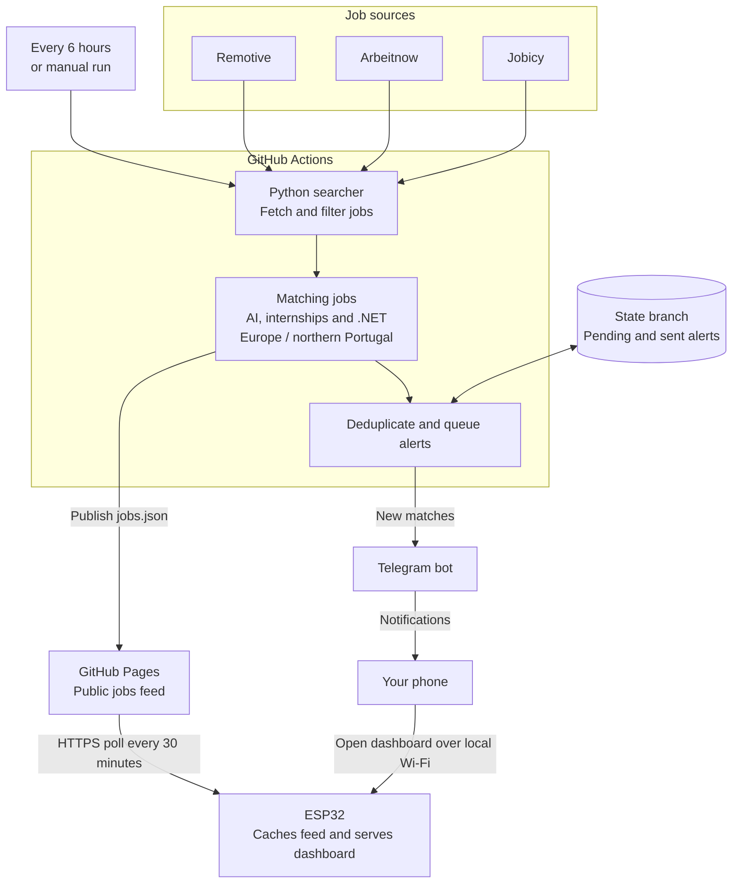

# ESP32 job radar

A personal job monitor with a scheduled Python searcher, Telegram notifications, a public GitHub Pages JSON feed, and a standalone ESP32 web dashboard. The ESP32 does not need to be on for searches or Telegram alerts to run.

## How it works



The cloud workflow searches and sends notifications even when the ESP32 is off. When it is on, the ESP32 displays the latest published results in a web page you can open on your local network.

## Search scope and limitations

- Roles: AI/LLM software engineering, AI internships/graduate roles, and C#/.NET backend or full-stack engineering. Senior/lead titles and explicitly junior .NET roles are excluded. This is keyword matching, not an AI evaluation of your CV; edit `classify()` in `searcher/job_alerts.py` to tune it.
- Locations: remote listings mentioning Portugal, Europe, EMEA or worldwide; local Arbeitnow listings in Viseu, Aveiro or Porto. Local listings **may be onsite**, not hybrid. Verify every job's eligibility and work arrangement; the filters cannot reliably interpret every restriction.
- [Remotive](https://remotive.com/api-documentation) supplies remote software jobs with a **24-hour publication delay**. [Jobicy](https://jobicy.com/jobs-rss-feed) supplies remote engineering jobs from the last **7 days**, with a 3-hour delay; queries cover Europe, Portugal and EMEA. [Arbeitnow](https://www.arbeitnow.com/blog/job-board-api) covers European jobs, including local listings. The searcher reads at most five Arbeitnow pages per run and five Jobicy pages per geography. Coverage is incomplete; the APIs can return few or no Portugal jobs. Sources can change availability and terms.
- Jobs generally must be posted within the last 14 days. The dashboard shows at most 40 newest matches; delivery is limited to 20 alerts per run, with remaining jobs queued. Source duplicates are identified by source and ID, not across different sites. Listings can close after being fetched; check the original posting.
- GitHub Actions runs every six hours at minute 17. Schedules can be delayed by GitHub. ESP32 refreshes every 30 minutes and retries failures every two minutes. These intervals are separate.

## 1. Create a GitHub repository

Create a **new repository** and upload the contents of `job-alerts/` as its root (so `.github/workflows/job-alerts.yml` is at the repository root). A public repository is the simplest option for free GitHub Pages; Pages availability for private repositories depends on your GitHub plan. Do not upload `config.h` or any credentials.

In **Settings → Actions → General → Workflow permissions**, allow read and write permissions. In **Settings → Pages**, choose **GitHub Actions** as the build and deployment source. The workflow creates a `job-alerts-state` branch containing the outbox and sent IDs; keep this branch intact. GitHub Pages publishes only `jobs.json`, not `state.json`.

The feed is public at `https://USERNAME.github.io/REPOSITORY/jobs.json` after the first successful deployment. This URL exposes your selected job matches and search times to anyone who knows it. It does not contain your CV or Telegram credentials. Don't store sensitive information in the published feed.

## 2. Configure Telegram

1. Message [@BotFather](https://t.me/BotFather), create a bot, and save its token.
2. Open your new bot in Telegram and press **Start**, then send it a message.
3. In a private browser session, open `https://api.telegram.org/bot<YOUR_BOT_TOKEN>/getUpdates` and find the numeric `message.chat.id` for your chat. Keep the token and URL private. If another client already consumes the updates, use the chat ID from that client instead.
4. In GitHub **Settings → Secrets and variables → Actions**, create repository secrets `TELEGRAM_BOT_TOKEN` and `TELEGRAM_CHAT_ID`.
5. In **Actions → Search and publish jobs**, select **Run workflow**. Inspect the run and confirm a message arrives if matches exist. The initial run alerts for all currently matching listings, subject to the 20-message limit.

An alert is marked sent after Telegram accepts it; failures stay pending for a later run. A crash or failed Git push after Telegram accepts a message but before the state is persisted can result in a duplicate on retry. Workflow concurrency prevents scheduled/manual runs overlapping. The workflow reports a failure if every source fails or Telegram delivery fails; individual source failures are included in the feed, with previous results retained temporarily. Check Actions logs when no alerts arrive.

## 3. Set up the ESP32

1. Install the **ESP32 by Espressif Systems** board package in Arduino IDE. This sketch uses its built-in WiFi, HTTPClient, and WebServer libraries; no extra library or filesystem upload is required.
2. Copy `firmware/job_alerts/config.example.h` to `firmware/job_alerts/config.h`, fill in your Wi-Fi credentials and the actual GitHub Pages `jobs.json` URL. The sketch expects an HTTPS host whose certificate chains to ISRG Root X1. It synchronizes its clock over NTP for TLS verification.
3. Open `firmware/job_alerts/job_alerts.ino`, select your ESP32 board and port, and upload. Use a partition layout with enough room for the sketch (the default generally works).
4. Open Serial Monitor at **115200 baud**. Once connected, open the printed dashboard URL on a device on the same Wi-Fi network. Allow a few minutes for time synchronization and the first feed download. The ESP32 retains its most recent feed in RAM during network errors, but not across reboots. HTTP access to the dashboard is intended for a trusted local network.

If the page says the feed is unavailable, check the Pages deployment and feed URL, internet/DNS access, NTP access, and TLS trust chain. GitHub Pages normally provides a content length; this sketch rejects chunked/unknown-length or larger-than-64-KiB feeds. If the certificate authority changes, update the root certificate in the sketch.

## Local operation and verification

Python 3.10+ and the standard library are sufficient:

```sh
python3 searcher/job_alerts.py scan --directory public
python3 -m unittest discover -s tests -v
```

`scan` writes `jobs.json` and `state.json` under the selected directory. To actually send queued messages locally, set `TELEGRAM_BOT_TOKEN` and `TELEGRAM_CHAT_ID` in your environment and run `python3 searcher/job_alerts.py deliver --directory public`. Local state is independent of the GitHub workflow's state branch; using both will generate duplicate alerts. Do not put credentials in the feed, source code, logs, or repository.
# JobAlert
